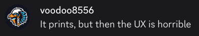
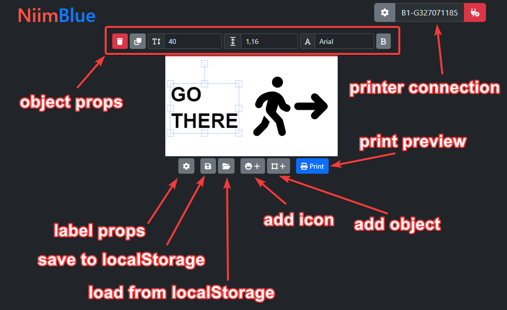
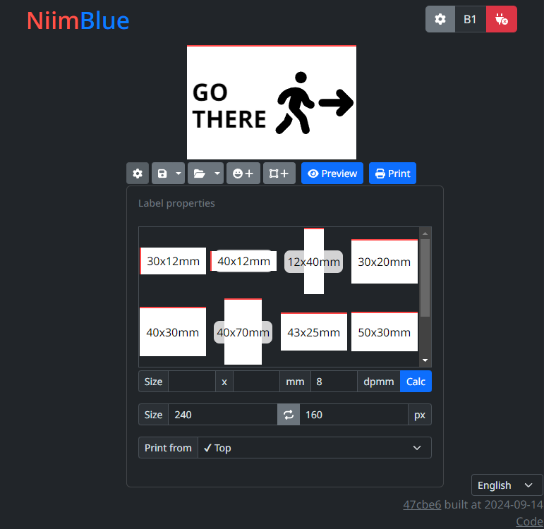
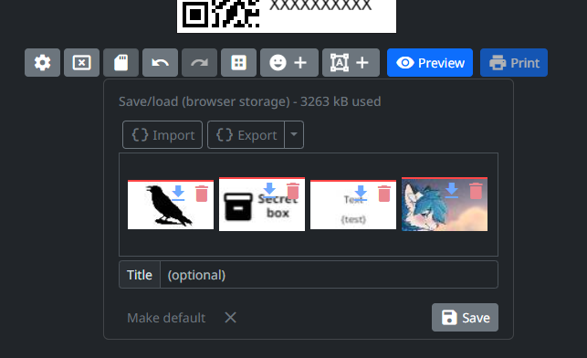
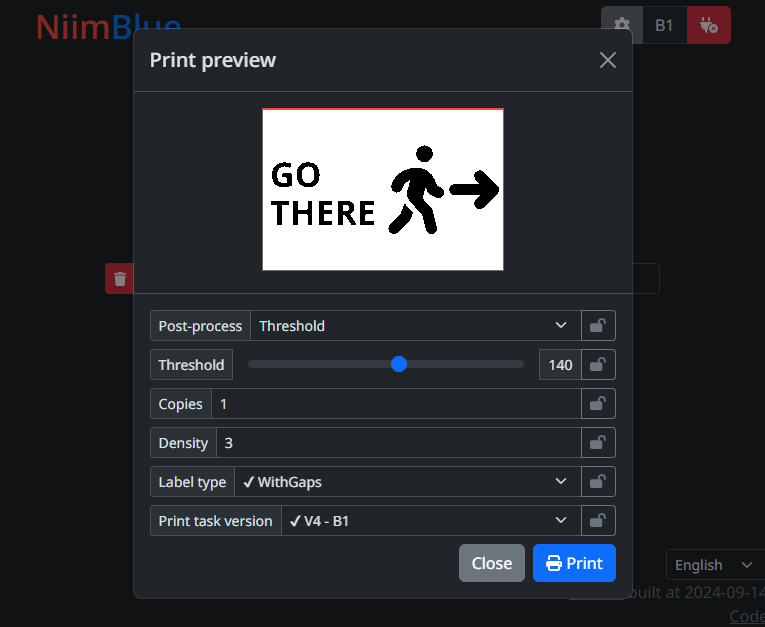
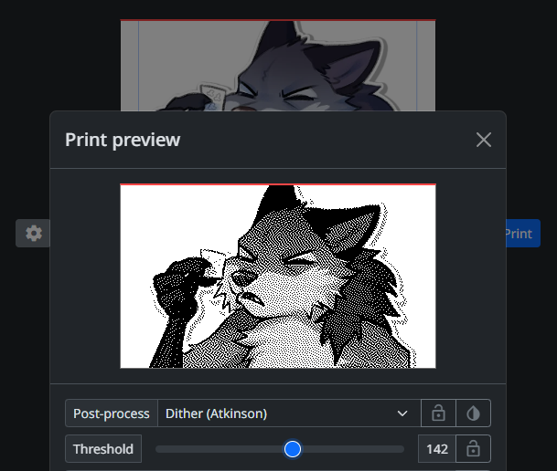
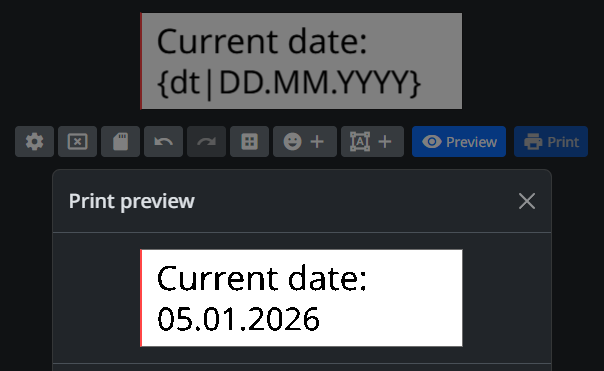
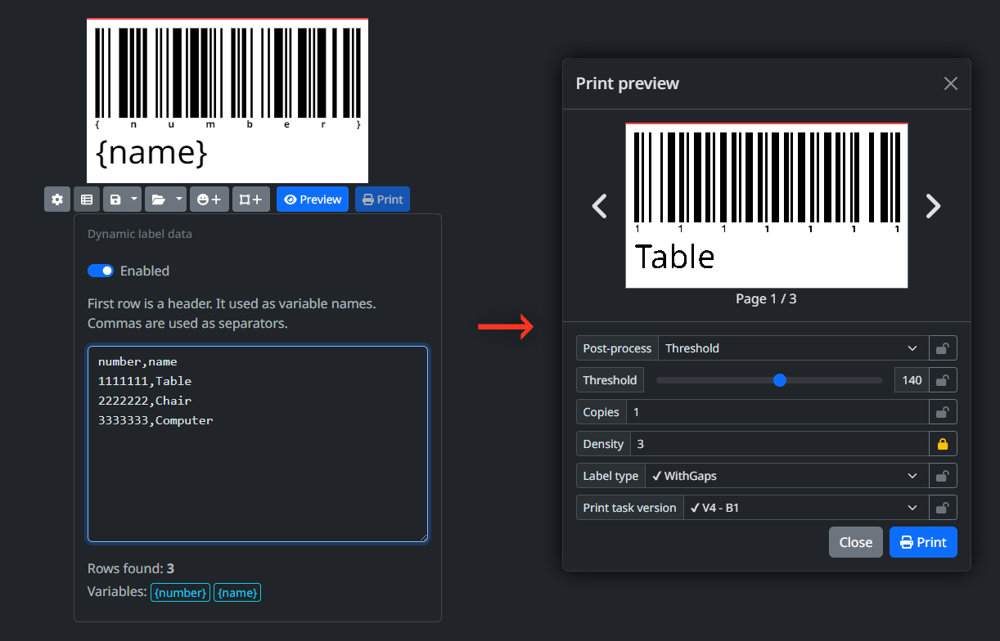
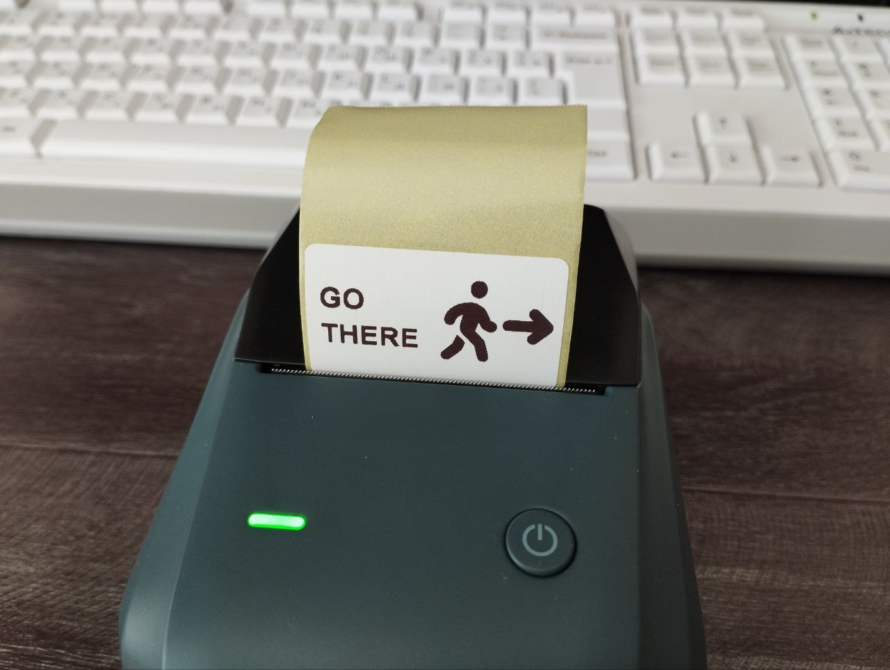
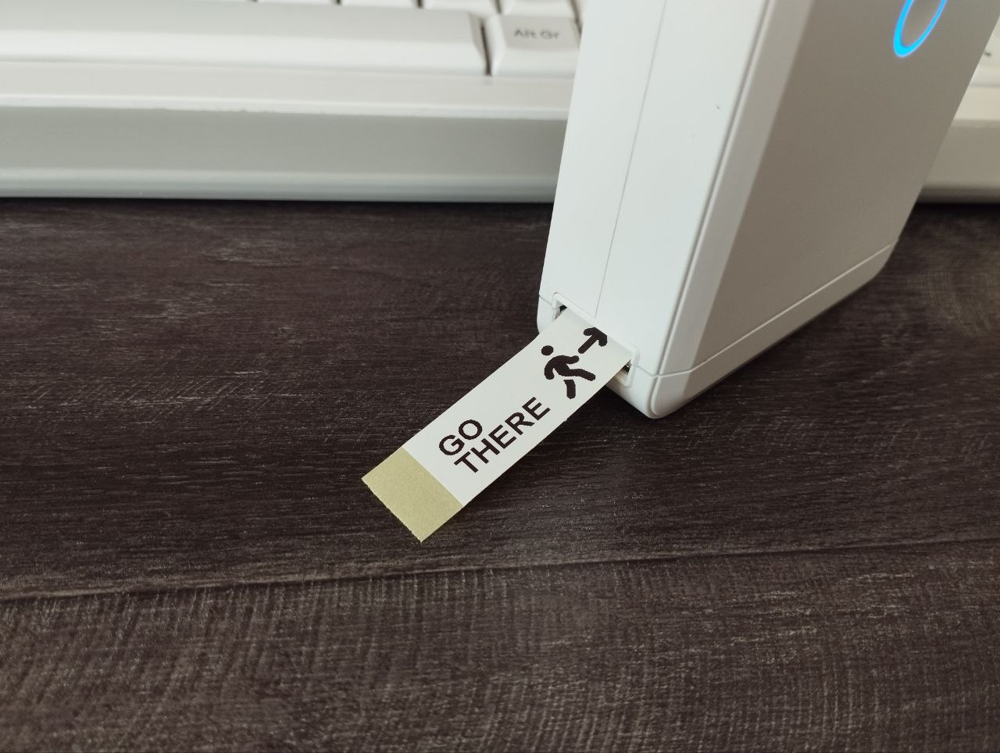

<div align="center">

[](https://niim.blue)

# NIIMBOT printers webui



Design and print labels right from your browser

[FAQ](https://github.com/MultiMote/niimblue/wiki/Frequently-asked-questions) | [Discord](https://discord.gg/jXPAfZVd8a) | [Telegram](https://t.me/niimblue) |  [NIIMBOT Community Wiki](https://printers.niim.blue)

[NiimBlueLib](https://github.com/MultiMote/niimbluelib) is used for communication

Deployments:

[niim.blue](https://niim.blue)  main | [dev.niim.blue](https://dev.niim.blue)  dev | [2.niim.blue](https://2.niim.blue)  main

Give thanks:

[Boosty](https://boosty.to/multimote) | [Lava](https://app.lava.top/mithriss_art?tabId=donate) (less fees)


</div>

## Features

* Privacy first! All your data is stored in your browser and never sent anywhere. Printing goes directly to the printer via Bluetooth or USB. The following requests are still made:
    - Application files are downloaded from the server the app is hosted on.
    - Update check on startup: the latest release version is fetched from GitHub (`api.github.com`).
    - Changelog: fetched from GitHub (`raw.githubusercontent.com`) when you open the changelog dialog.
    - Cloud label presets: when you create a preset from an RFID tag (after confirmation), its barcode is sent to the official NIIMBOT cloud (`print.niimbot.com`) or the `rfid.niim.blue` mirror.
* Support for both Bluetooth and USB connections.
* Rich label editor. Label saving, import/export.
* Print preview. You can see how your label will look like after post-processing. Several post-processing algorithms are available.
* [Standalone apps](https://github.com/MultiMote/niimblue/releases):
    - Android (Tauri based, native Bluetooth)
    - Windows and Linux (Tauri based, native Bluetooth)
* Most complete implementation of [NIIMBOT protocol](https://printers.niim.blue/interfacing/proto/).

You can see more complete list of implemented and planned features [on the Wiki](https://github.com/MultiMote/niimblue/wiki#features).

Demonstration video:

[](https://www.youtube.com/watch?v=u8QX-5e3W_A)

## Supported printers

There is no exact list of supported models in this project. This project aims to support the maximum number of models.

You can check [a list of tested models here](https://github.com/MultiMote/niimbluelib/issues/1). If you own other model, please write a comment.

If your (new) printer model does not print, please make a [packet dump](https://github.com/MultiMote/niimblue/wiki/Making-packet-capture) of print with official application.

> [!NOTE]
> If you have printing problems, try different print task versions in print preview dialog. Make if default by pressing "Lock" button.


## Supported browsers

Your browser must support Web Bluetooth API: [supported browsers](https://developer.mozilla.org/en-US/docs/Web/API/Web_Bluetooth_API#browser_compatibility).

For serial communication: [supported browsers](https://developer.mozilla.org/en-US/docs/Web/API/Web_Serial_API#browser_compatibility).

Modern Chrome-based browsers should usually work.

In some systems you need to enable Chrome `Web Bluetooth` or `Experimental Web Platform Features` (navigate to `chrome://flags`).

Safari: while, this browser has no native `Web Bluetooth`, there is [beacio extension](https://beacio.com/) that enables Web Bluetooth under Safari.
Setup details available [here](https://beacio.com/setup).

## Images

Images may be outdated.



<details>
<summary>⬇ More images ⬇</summary>

Label properties:



Save/load menu:



Print preview dialog:



Post-processing:



Templating:



Dynamic data:



In real life:




</details>


## Development

### Launching development server

Skip steps you have done.

1. Install [git](https://git-scm.com)

2. Install [nodejs](https://nodejs.org)

3. Clone repository

    ```bash
    git clone https://github.com/MultiMote/niimblue.git
    ```

4. Install dependencies

    ```bash
    npm i
    ```

5. Run dev server

    Check code and run:

    ```bash
    npm run dev-check
    ```

    Or just run:

    ```bash
    npm run dev
    ```

### Deployment

Here are some options. HTTPS is required for non-localhost deployments.

#### Serving static files

To get static files run `npm run build` (result builds to `dist`) or download `niimblue-dist.zip` from [Releases](https://github.com/MultiMote/niimblue/releases).

#### Using Docker Image

Follow the instructions in the [wiki](https://github.com/MultiMote/niimblue/wiki/Running-own-instance-with-Docker).

### Desktop standalone app (Tauri)

The desktop app is located in `standalone-apps/tauri` and is built for both Windows and Linux.
It uses `tauri-plugin-blec` and the system Bluetooth stack instead of Web Bluetooth.

Linux system dependencies:

```bash
sudo apt install libwebkit2gtk-4.1-dev libgtk-3-dev libayatana-appindicator3-dev librsvg2-dev patchelf
```

Development:

```bash
cd standalone-apps/tauri
npm i
npm run dev-www # in one terminal
npm run tauri dev # in another terminal
```

Build (on Linux, `src-tauri/tauri.linux.conf.json` is applied automatically):

```bash
cd standalone-apps/tauri
npm run build-www
npm run tauri build
```

Packages are written to `standalone-apps/tauri/src-tauri/target/release/bundle`.

The regular `npm run build` in the repository root still produces a pure web build without
any Tauri dependencies.

### IDE setup

Project uses path aliases.

VSCode (settings.json):

```json
{
  "typescript.preferences.importModuleSpecifier": "non-relative",
  "javascript.preferences.importModuleSpecifier": "non-relative"
}
```

## Translations (click to contribute)

[](https://weblate.mmote.ru/engage/niimblue/)
